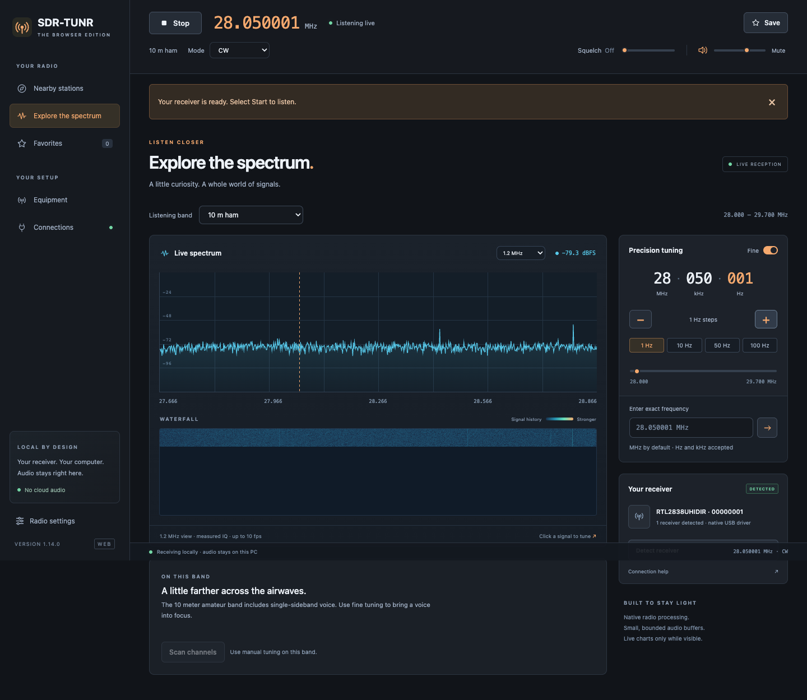
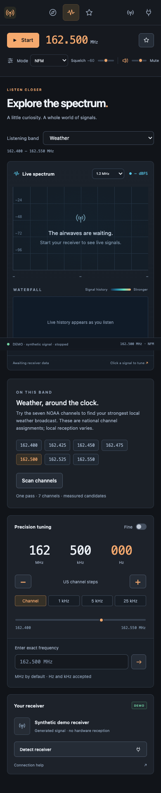

# SDR-TUNR

**Your radio, in your browser.**

SDR-TUNR is a local-first browser receiver for RTL-SDR hardware. It combines the native 1.14.0 C radio engine with a lightweight browser interface for tuning, listening, spectrum analysis, station discovery, and receiver setup.

> [!IMPORTANT]
> The hosted site is a clearly labeled synthetic demo. Real radio reception uses the downloadable local package and a small localhost bridge connected to the computer that owns the SDR.

## Screenshots

### Desktop receiver

*Local hardware acceptance capture at 28.050001 MHz in CW mode. It demonstrates the receiver and browser transport path; it is not a claim about station intelligibility or RF calibration.*

### Mobile layout

  

*390-pixel responsive layout in explicitly labeled synthetic demo mode.*

## Feature overview

| Area | Included in the browser preview |
| --- | --- |
| Reception | Local RTL-SDR capture through `librtlsdr` and the shared native C radio core |
| Modes | NFM/FM, Wide FM, AM, USB, LSB, and CW |
| Tuning | Exact integer-Hz tuning from 25–1750 MHz, band-aware steps, fine tuning down to 1 Hz, direct entry, sliders, and click-to-tune plots |
| Visualization | Live spectrum, waterfall history, dBFS power, tuned-frequency marker, and three display widths |
| Discovery | Bundled airport and repeater directory, U.S. ZIP search, nine categories, radius filters, and one-click tuning |
| Channel plans | FM broadcast, airband, 2 m, 70 cm, NOAA Weather, GMRS, FRS, MURS, rail, marine, 10 m, and 6 m |
| Scanning | Bounded one-pass checks of exact channel targets with measured-power results |
| Personalization | Named browser-local favorites that preserve exact frequency and receive mode |
| Receiver setup | Device detection and selection, gain, PPM correction, squelch, volume/mute, antenna guidance, and connection diagnostics |
| Responsive UI | Desktop sidebar, compact icon rail, mobile top navigation, keyboard focus states, and reduced-motion support |

## Radio and tuning

- Start and stop the receiver without reserving the SDR while the tab is idle.
- Receive in **NFM/FM, Wide FM, AM, USB, LSB, and CW** using the same core demodulators as the native 1.14.0 build.
- Tune any integer-Hz frequency in the browser receiver's **25–1750 MHz** range, subject to the connected tuner's actual coverage.
- Choose among 12 listening bands and their appropriate default modes and channel plans.
- Switch between normal and fine precision; supported steps range from service-specific channel spacing to **1 Hz** for CW.
- Tune with `+`/`−` controls, a band slider, an exact-frequency field, channel shortcuts, or by selecting a point on the spectrum or waterfall.
- Enter frequencies in MHz by default or add explicit Hz, kHz, or MHz units.
- Adjust squelch, volume, mute, RF gain, PPM correction, and receiver selection.

## Spectrum, waterfall, and audio

- View live FFT spectrum data and bounded waterfall history with a tuned-frequency marker and dBFS reading.
- Select a **1.2 MHz, 300 kHz, or 75 kHz** spectrum window.
- Run spectrum processing in a separate worker at up to 10 frames per second; inactive or hidden views pause chart work.
- Stream 48 kHz mono audio to an AudioWorklet outside the UI thread.
- Keep playback responsive with bounded audio queues, a startup reserve, stale-audio dropping, and diagnostics for queued audio, underruns, and dropped frames.
- Keep raw continuous IQ out of the UI thread.

## Channel plans and scanning

- Browse receive-only U.S. plans for NOAA Weather, GMRS/FRS, MURS, rail, and marine channels, plus FM broadcast and civil airband ranges.
- Explore amateur allocations for 2 m, 70 cm, 10 m, and 6 m with mode-aware tuning increments.
- Run a local, bounded one-pass channel check and review up to 12 of the strongest measured candidates above the selected squelch threshold.
- Treat scan results as measured energy only; a peak does not identify a station or guarantee intelligible audio.

## Nearby station directory

- Find listening candidates by five-digit U.S. ZIP code using an approximate ZIP-center location.
- Search by station, airport, or frequency and filter within **25, 50, 100, or 200 miles**.
- Browse Recommended, Weather, Airports, Ham, GMRS, FRS, MURS, Rail, and Marine categories.
- Tune a result with one click while retaining its receive mode.
- Load only the geographic tiles needed for the current search.
- Use a bundled snapshot of **18,338 FAA airport frequencies** and **9,102 HearHam repeater entries**—27,440 records across 621 geographic tiles.
- Use national channel plans without a location lookup. Zippopotam.us is the only external request used for nearby ZIP discovery.

## Favorites and setup

- Save, name, edit, remove, and retune exact favorite frequencies.
- Preserve each favorite's receive mode in browser-local storage; `Ctrl+D`/`Cmd+D` opens quick-save inside the app.
- Choose common Nooelec NESDR Mini and SMArt models or another RTL-SDR and view connector/range notes.
- Review practical antenna guidance for weather, FM, and airband reception.
- Follow the visual connection path: **browser → localhost bridge → RTL-SDR**.
- Detect receivers through the native driver and inspect queue, underrun, and dropped-frame diagnostics.
- Optionally identify a USB device with WebUSB in a supported browser. Identification does not start reception and does not replace the local bridge.

## Hosted demo and local receiver

| Hosted browser demo | Downloadable local receiver |
| --- | --- |
| Generated tone and spectrum | Live capture from connected RTL-SDR hardware |
| Explicitly labeled `DEMO · SYNTHETIC SIGNAL` | Local bridge calls the native C radio engine |
| No driver, socket, microphone, USB, or hardware request | Uses the installed RTL-SDR driver and `librtlsdr` |
| Start/Stop and tuning UI for evaluation | Full receiver, gain/PPM/device, scan, audio, and diagnostics controls |
| Useful for interface testing | Required for real listening |

## Local by design

Audio and radio data stay on the receiver computer. The bridge binds to loopback, uses bounded queues, and allows one listening tab to own the SDR at a time. The bundled station directory loads locally; only an intentional ZIP lookup contacts an external service. Favorites remain in the current browser profile and origin.

## Browser-preview scope

This is a focused browser preview, not complete parity with the native application.

- macOS hardware capture and browser transport were exercised across all six receive modes with browser volume muted. That verifies the path, not intelligible station audio or long-duration RF performance.
- Windows compilation, Windows USB reception, and intelligible station reception still require target-machine acceptance testing.
- Directory entries are snapshots, not live station-status data.
- The one-pass browser channel checker is not the native continuous multi-band scanner or a full band survey.
- ADS-B aircraft tracking and maps, propagation guidance, Morse text decoding, native band surveys, continuous scan/hold/skip/resume behavior, recording, trunk tracking, and other digital protocols are not included in the browser preview.

## Download and rebuild

- [Download the SDR-TUNR 1.14.0 browser-preview package](dist/downloads/SDR-TUNR-1.14.0-browser-preview.zip) for the local receiver source, verification material, and packaging scripts.

This repository contains the static browser preview. After extracting the downloadable package, refresh the web build from its `SDR-TUNR-Web` root with `scripts/package-web.py`, then `scripts/prepare-web-site.py`.
