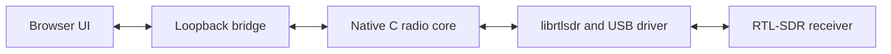

# SDR-TUNR

**Your radio, in your browser.**

SDR-TUNR 1.14.0 is a receive-only, local-first browser interface for RTL-SDR hardware. It combines a native C radio core with a responsive web UI for six demodulation modes, exact-Hz tuning, live spectrum and waterfall views, channel discovery, one-pass scanning, favorites, and receiver diagnostics.

> [!IMPORTANT]
> This repository contains two intentionally different experiences. The static `dist/` app is a clearly labeled **synthetic interface demo**: it generates a tone and spectrum and never contacts USB hardware or the local receiver bridge. **Real radio reception requires the downloadable local package**, its loopback bridge, a compatible RTL-SDR, and the operating system's RTL-SDR driver.


*Local-hardware acceptance capture on macOS. It verifies the receiver-to-browser transport path; it does not establish station intelligibility, RF calibration, or long-duration reliability.*

[Features](#features) · [Quick start](#quick-start) · [Bands](#bands-and-modes) · [Architecture](#how-real-reception-works) · [Platforms](#platform-status) · [Verification](#verification) · [Troubleshooting](#troubleshooting)

## Features

| Area | Static interface demo | Local RTL-SDR receiver |
| --- | --- | --- |
| Signal source | Generated tone and synthetic spectrum | Connected RTL-SDR through `librtlsdr` and the native C core |
| Receive modes | Mode and tuning controls can be explored | NFM/FM, Wide FM, AM, USB, LSB, and CW demodulation |
| Tuning | UI behavior from 25–1750 MHz | Integer-Hz tuning from 25–1750 MHz, limited by the connected tuner's actual coverage |
| Precision | Exact entry, band slider, channel shortcuts, normal/fine controls | The same controls, with mode-aware steps down to 1 Hz in CW |
| Visualization | Generated spectrum and waterfall | Live 4096-point spectrum, bounded waterfall history, dBFS power, and 1.2 MHz / 300 kHz / 75 kHz views |
| Discovery | Bundled channel and station directory | U.S. ZIP search, radius and text filters, national plans, airports, repeaters, and one-click tuning |
| Scanning | Disabled to avoid implying measured RF | Bounded one-pass checks of exact targets, reporting up to 12 candidates above the squelch threshold |
| Favorites | Browser-local names, frequencies, and modes | The same browser-local storage, scoped to the current origin and port |
| Receiver controls | Hardware controls disabled | Device selection, RF gain, PPM correction, squelch, volume, mute, Start/Stop, and diagnostics |
| Hardware access | None: no driver, bridge socket, microphone, or USB request | Loopback bridge → native core → installed RTL-SDR library → USB receiver |

Additional interface details include click-to-tune plots, explicit Hz/kHz/MHz entry, channel-aware stepping, antenna and receiver guidance, visible keyboard focus, descriptive control labels, a `Ctrl+D` / `Cmd+D` favorite shortcut, responsive navigation, and reduced-motion support.

## Quick start

### Explore the synthetic demo

The demo is useful for reviewing the interface without hardware. From the repository root:

```sh
git clone https://github.com/bentaylor64/SDR-TUNR.git
cd SDR-TUNR
python3 -m http.server 8000 --directory dist
```

Open `http://127.0.0.1:8000/`. The UI must remain labeled **DEMO · SYNTHETIC SIGNAL**. Demo output is not evidence of USB access, RF reception, or native demodulator behavior.

### Listen with an RTL-SDR

1. Download [`SDR-TUNR-1.14.0-browser-preview.zip`](dist/downloads/SDR-TUNR-1.14.0-browser-preview.zip?raw=1).
2. Verify its SHA-256 against [`SDR-TUNR-1.14.0-browser-preview.zip.sha256`](dist/downloads/SDR-TUNR-1.14.0-browser-preview.zip.sha256).
3. Extract the archive and enter its `SDR-TUNR-Web` directory.
4. Install the platform prerequisites in [Platform status](#platform-status).
5. Start the local app:

   ```sh
   python3 scripts/run-web.py
   ```

   On Windows, use `py -3 scripts/run-web.py` after completing the Windows build step.

The launcher builds the native core when needed, starts the bridge on `http://127.0.0.1:8780`, and opens the browser. Keep the launcher running, choose **Connections → Detect receiver**, then press **Start**. Opening a tab only probes availability; Start claims the SDR, and Stop releases it.

To verify the files in a cloned repository:

```sh
cd dist/downloads
sha256sum -c SDR-TUNR-1.14.0-browser-preview.zip.sha256
```

Expected SHA-256:

```text
292b735b21dcb35a8f555547dd268339d3be56867da3774c8ca8f609802da05b
```

## Bands and modes

The UI exposes six receive modes: **NFM** (represented internally as `FM`), **Wide FM**, **AM**, **USB**, **LSB**, and **CW**. These are receive-only controls; Wide FM audio is mono in this preview.

| Listening band | Range | Default | Default mode | Listed / scan targets |
| --- | ---: | ---: | --- | ---: |
| FM broadcast | 88–108 MHz | 99.500 MHz | Wide FM | 100 |
| Air band | 118–137 MHz | 125.000 MHz | AM | 760 |
| 2 m amateur | 144–148 MHz | 146.520 MHz | NFM | 290 scan targets |
| 70 cm amateur | 420–450 MHz | 446.000 MHz | NFM | 400 scan targets |
| NOAA Weather | 162.400–162.550 MHz | 162.500 MHz | NFM | 7 |
| GMRS | 462.5375–467.725 MHz | 462.675 MHz | NFM | 22 |
| Rail | 160.2025–161.5775 MHz | 160.215 MHz | NFM | 91 |
| Marine | 156.0375–161.6125 MHz | 156.800 MHz | NFM | 39 |
| MURS | 151.8075–154.6125 MHz | 151.820 MHz | NFM | 5 |
| FRS | 462.5375–467.725 MHz | 462.5625 MHz | NFM | 22 |
| 10 m amateur | 28–29.7 MHz | 28.400 MHz | USB | Manual tuning |
| 6 m amateur | 50–54 MHz | 50.090 MHz | CW | Manual tuning |

Listed channels are tuning candidates, not proof that a transmitter is active or that a signal is legally receivable in every location. Scan results represent measured energy above the selected dBFS threshold; they do not identify a station or guarantee intelligible audio.

## Discovery, favorites, and setup

- Search bundled stations by name, airport, or frequency and filter within 25, 50, 100, or 200 miles of an approximate U.S. ZIP-code center.
- Browse Recommended, Weather, Airports, Ham, GMRS, FRS, MURS, Rail, and Marine categories. National plans work without entering a location.
- Tune a directory result with its receive mode, or save a named favorite containing the exact frequency and mode.
- Select common Nooelec NESDR Mini and SMArt families or another RTL-SDR, then review connector, coverage, and antenna guidance.
- Detect multiple receivers, choose a device, and adjust gain, PPM correction, squelch, volume, and mute.
- Inspect queued audio, underruns, and dropped-frame counters. These are transport diagnostics, not calibrated RF measurements.
- Optionally identify a USB device with WebUSB in a supporting browser. Identification neither claims the radio nor replaces the bridge.

### Responsive layout


*The verified 390-pixel mobile capture is intentionally shown in stopped synthetic-demo mode. Desktop and mobile acceptance found no horizontal overflow.*

### Keyboard and accessibility notes

- Visible focus rings, semantic landmarks, native form controls, descriptive labels, and status announcements support keyboard and assistive-technology use.
- `Ctrl+D` / `Cmd+D` opens quick-save inside the app. Arrow keys operate focused sliders using the selected tuning step.
- Reduced-motion preferences suppress nonessential animation, and the layout adapts through full-sidebar, compact-rail, and mobile navigation states.
- Spectrum and waterfall canvases support pointer tuning; equivalent frequency entry, step buttons, and sliders remain available without using the plots.

The interface is accessibility-minded, but this preview does not claim WCAG or screen-reader conformance.

## How real reception works

The complete local path is: **browser UI → Python loopback bridge → native C radio core → `librtlsdr` and the operating-system USB driver → RTL-SDR**. The following diagram presents the same path visually; no cloud service sits in the audio path.



- The native engine processes 1.536 MS/s IQ and supplies all six demodulators; raw continuous IQ does not pass through the UI thread.
- A socket worker transfers 48 kHz mono Float32 audio to an AudioWorklet through a direct message channel.
- The playback ring begins with a 64 ms reserve and caps queued audio at 160 ms, dropping stale samples to return to live playback.
- The bridge bounds its outbound audio queue at six packets and disconnects a socket that cannot drain within 500 ms.
- A separate worker computes a 4096-point spectrum at no more than 10 frames per second, with one frame in flight. Hidden or inactive spectrum views pause chart work.
- Fine tuning can reuse a stationary capture center; reset fences discard old audio and spectrum after a retune.

Queue sizes are design bounds, not end-to-end latency guarantees. USB scheduling, the browser, and the audio device add delay.

## Local privacy and security

- The receiver bridge binds only to IPv4 loopback (`127.0.0.1`); it has no LAN-listening mode.
- Exact loopback Host checks, same-origin validation, no cross-origin access, and a random process-session token protect its HTTP/WebSocket boundary.
- One browser tab owns the receiver stream at a time. Stop, tab close, or disconnect releases it.
- Audio and radio samples remain on the receiver computer. The app does not request microphone access.
- Favorites and UI settings stay in that browser profile's local storage and are separated by origin, including the localhost port.
- Airport and repeater catalogs are bundled and loaded by geographic tile only when needed.
- Entering a U.S. ZIP code intentionally requests an approximate ZIP-center location from Zippopotam.us. That lookup is the directory's only required external request.
- The static demo makes no bridge, USB, driver, or hardware request.

The bridge is intended for a single-user desktop. A process already authorized to run locally can still reach localhost, so normal operating-system account security remains important.

## Directory data and provenance

| Dataset | Snapshot | Records | Notes |
| --- | --- | ---: | --- |
| Airport frequencies | FAA NASR cycle 2026-09-03, retrieved 2026-09-12; OurAirports IATA metadata | 18,338 | Voice-frequency candidates with source metadata retained |
| Repeaters | HearHam download dated 2026-09-12 | 9,102 | 9,081 amateur and 21 GMRS entries; download date is not a verification date |
| Combined directory | Lossless geographic partition of the two native snapshots | 27,440 | 621 JSON tiles, each covering a 2° × 2° cell |
| National plans | NOAA, FCC, AAR/CISA, USCG, and ARRL references | Separate from local tiles | Available without a ZIP lookup; no invented local coordinates |

[`dist/data/SOURCES.md`](dist/data/SOURCES.md) documents the bundled sources. [`dist/data/catalogs.json`](dist/data/catalogs.json) retains original attribution, dates, source URLs, source SHA-256 values, and tile counts. The model tests compare each tiled record with the native snapshot. Directory records are published listening candidates, not live station-status data or evidence of reception.

## Platform status

| Platform | Requirements | Status for 1.14.0 browser preview |
| --- | --- | --- |
| macOS / Apple silicon | Python 3.9+, locally installed `librtlsdr`; Xcode Command Line Tools if rebuilding | Physical RTL2838UHIDIR capture and browser transport verified on macOS 26.6.2 with Brave 153.1.95.101. The archive includes the acceptance machine's Apple-silicon core. |
| macOS / other architecture | Python 3.9+, C compiler, `librtlsdr` from Homebrew or MacPorts | Rebuild the native core for the target architecture; not covered by the packaged binary. |
| Linux | Python 3.9+, C compiler with pthreads, `librtlsdr`, and distribution-appropriate USB/udev permissions | Implementation and `.so` build path are included; target-machine hardware validation remains outstanding. |
| Windows 64-bit | Python 3.9+, WinUSB on the SDR interface, matching 64-bit `rtlsdr.dll` / `librtlsdr.dll` and `libusb-1.0.dll`, MSYS2 UCRT64 MinGW-w64 GCC for the one-time core build | Implementation is included, but no prebuilt Windows DLL or Windows hardware acceptance result is included. |
| Browser | AudioWorklet support; a current Chromium browser is the primary target | Brave/Chromium was used for acceptance. Chrome or Edge can expose the optional WebUSB identity picker; other AudioWorklet browsers need separate validation. WebUSB is not required for bridge reception. |

<details>
<summary><strong>Windows build notes</strong></summary>

Install WinUSB only for the SDR's correct interface (commonly RTL2832U Bulk-In Interface 0); do not replace unrelated device drivers. From an environment with Python and MSYS2 UCRT64 available:

```powershell
$env:RTLSDR_LIBRARY = 'C:\SDR\rtlsdr.dll'
py -3 scripts/build-web-core.py --cc C:/msys64/ucrt64/bin/gcc.exe
py -3 scripts/run-web.py
```

Python, the native core, and the RTL-SDR DLLs must share the same architecture. `RTLSDR_LIBRARY`, when used, must be an absolute path. The compiler is required to build the core, not for routine listening.

</details>

<details>
<summary><strong>macOS and Linux build notes</strong></summary>

```sh
python3 scripts/build-web-core.py
python3 web/bridge/server.py --open
```

On Linux, configure the receiver's USB permissions and release any conflicting DVB driver or SDR application. On macOS, existing MacPorts, Homebrew Apple-silicon, and `/usr/local` installations are detected.

</details>

## Verification

Release evidence is dated **September 16, 2026**. Hardware checks used macOS 26.6.2, Apple silicon, Brave 153.1.95.101, Python 3.9, an installed RTL-SDR library, and a real RTL2838UHIDIR. Browser volume was muted while nonzero audio samples were checked before the volume control.

| Check | Result | What it establishes |
| --- | ---: | --- |
| Native application suite | 255 tests in 31 suites passed | Existing 1.14.0 receiver behavior remained intact |
| Browser model/audio/lifecycle suite | 52 tests passed | Exact tuning, channel parity, directory copying, favorites, queue limits, resampling, spectrum orientation, and lifecycle behavior |
| Loopback bridge suite | 18 tests passed | Validation, token/origin/owner guards, binary streaming, retune ordering, squelch, disconnect cleanup, and bounded queues |
| Sanitizer suite | 6 tests passed | Native capture checks under AddressSanitizer and UndefinedBehaviorSanitizer |
| Physical receiver modes | FM, WFM, AM, USB, LSB, and CW streamed | USB capture → native core → bridge → worker → AudioWorklet path on the acceptance Mac |
| Fine tuning | 1 Hz CW adjustment retained the active capture center | Stationary-window fine-tuning path |
| Responsive browser | Desktop and 390 px mobile, no horizontal overflow | Layout behavior in the tested browser |
| Synthetic browser run | 12 seconds; 53 ms sampled queue, 0 underruns, 0 drops, 0 browser errors | Explicit demo transport and controls, not RF reception |
| Catalog regeneration | 27,440 unchanged records in 621 tiles | Lossless browser partition and source provenance |

### Brief hardware-run observations

| Mode | Frequency | Last sampled playback queue | Underruns | Audio/capture drops |
| --- | ---: | ---: | ---: | ---: |
| FM | 162.550 MHz | 59 ms | 0 | 0 |
| WFM | 99.500 MHz | 56 ms | 0 | 0 |
| AM | 125.000 MHz | 56 ms | 0 | 0 |
| USB | 28.400 MHz | 53 ms | 0 | 0 |
| LSB | 28.400 MHz | 53 ms | 0 | 0 |
| CW | 28.050 MHz | 61 ms | 0 | 0 |

Each mode ran for approximately 3.5 seconds, plus startup and fine-tuning checks. These sampled software counters are not an end-to-end latency measurement, calibrated RF result, long-duration reliability test, or performance prediction for another machine.

## Development

The repository root is the publishable static demo. Extract the included archive for the native core, local bridge, source, tests, research notes, and packaging scripts. Run the following commands from the extracted `SDR-TUNR-Web` directory.

Bridge and browser model tests require only Python's standard library and Node.js; no `pip` or `npm` install is required:

```sh
python3 -B -m unittest discover -s web/bridge -v
node --test Tests/Web/*.test.mjs
```

The full development tree recorded 52 passing browser tests. The downloadable preview archive currently reproduces 51 of 52 because its marine source-parity test references `Sources/Tuner/ServiceChannelPlans.swift`, a fixture not included in the archive; the functional browser tests pass.

Verify generated station tiles without rewriting them:

```sh
python3 scripts/build-web-catalogs.py --check
```

Run an explicit local synthetic transport for development:

```sh
python3 web/bridge/server.py --demo --port 8781 --open
```

Create a new source-and-browser-preview archive:

```sh
python3 scripts/package-web.py
```

The package includes a locally built core when present; rebuild it for a different operating system or architecture. Browser smoke tests additionally require Playwright and a Chromium executable. The full native application's capture and application suites live outside this preview package.

### Repository layout

| Path | Purpose |
| --- | --- |
| `dist/` | Self-contained static synthetic demo, local data tiles, and downloadable receiver package |
| `dist/data/` | Catalog manifest, provenance, and geographically partitioned airport/repeater records |
| `dist/downloads/` | Versioned local receiver archive and setup documentation |
| `docs/images/` | Verified desktop and mobile README captures |
| `dist/downloads/SDR-TUNR-1.14.0-browser-preview.zip.sha256` | Checksum manifest stored beside the downloadable archive |

## Troubleshooting

| Symptom | Check |
| --- | --- |
| UI says demo / synthetic signal | You opened the static demo. Extract the receiver package and launch its local bridge for hardware reception. |
| Local bridge unavailable | Run `python3 scripts/run-web.py`, keep its terminal open, and refresh the browser after a restart. Do not open `index.html` directly. |
| No receiver detected | Confirm the USB cable, OS driver, `librtlsdr`, and USB permissions; close other SDR/DVB software, then detect again. |
| Receiver in use | Stop reception in the other browser tab or SDR application. Only one tab owns the receiver. |
| Audio will not start | Allow sound for the local page and press Start again; browser audio activation must follow a user action. |
| Windows cannot load the driver/core | Match 64-bit Python, the native core, `librtlsdr`, `libusb`, and compiler runtime; use an absolute `RTLSDR_LIBRARY` path. |
| Favorites appear missing | Reopen the same browser profile, host, and port. Browser storage is origin-specific. |
| WebUSB can identify a device but reception fails | Identification is separate from reception. Check the loopback bridge, native driver, and device ownership. |
| Weak or noisy signal | Move the antenna away from computers, chargers, and metal first; then adjust gain and squelch. Use an antenna suited to the band. |

When reporting a problem, include version `1.14.0`, operating system and architecture, browser/version, receiver model, the exact action attempted, and the complete visible error. State whether the result came from the static synthetic demo or the local hardware receiver.

## Known limitations

- This is a focused browser preview, not full parity with the native application.
- Windows and Linux physical receiver operation remain unverified for this release. The macOS check verified transport with muted output, not intelligible station audio.
- Directory snapshots are not live status data, and ZIP-center distances are approximate.
- The one-pass checker visits listed targets and measures energy; it is not a continuous spectrum survey or station identifier.
- Native continuous multi-band/favorite scanning, hold/skip/resume policy, ADS-B aircraft tracking and maps, propagation guidance, Morse text decoding, recording, trunk tracking, and other digital protocols are not included.
- Wide FM is mono, with no stereo or RDS decoding. Direct sampling below 25 MHz is not exposed.
- There is no remote/LAN receiver mode, cloud favorites sync, or shared multi-tab receiver session.
- The browser range is 25–1750 MHz, but actual coverage and performance depend on the tuner, antenna, local conditions, and driver.
- U.S. service/channel plans are informational and receive-only. Users are responsible for following applicable laws and regulations.

## License status

No project license file is included with this release. Public repository visibility by itself does not grant permission to copy, modify, or redistribute the project. Unless the repository owner provides separate terms, all rights remain reserved.
